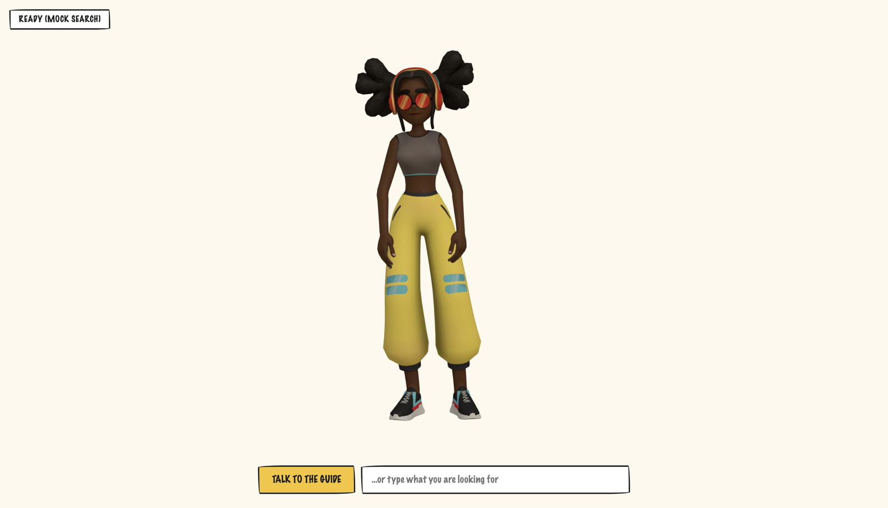

# For Albert: the screen Robert wants

Robert wants Agora to feel like talking to a person in a shop. The guide stands on the right, the products
appear on the left as round bubbles, and you just talk. This file explains that picture, shows the style it
must keep, says what already runs in this repo, and lists what is still missing.

Written on 14 Nov 2026 from Robert's description and from the code in this commit. Where something is a
suggestion and not Robert's decision, it says so.



*The guide page as it is today (`guide/`, opened with `?who=michelle&mock`). This is the look Robert wants to keep.*

---

## 1. The vision in one picture

```
┌──────────────────────────────────────────────────────────────────────────────┐
│ [ READING 8 SITES · 41 OFFERS ]                                              │
│                                                                              │
│      ╭─────────╮        ╭─────────╮                                          │
│      │  photo  │        │  photo  │                          ◖███◗           │
│      │ 180 EUR │        │ 240 EUR │                          (◉_◉)           │
│      │cheapest │        │new tyres│                           ╱│╲   ← the    │
│      ╰─────────╯        ╰─────────╯                          ╱ │ ╲    guide, │
│              ╭─────────╮        ╭─────────╮                    │      talking│
│              │  photo  │        │  photo  │                   ╱ ╲            │
│              │ 310 EUR │        │ 420 EUR │                  ╱   ╲           │
│              │near you │        │best gear│                                  │
│              ╰─────────╯        ╰─────────╯                                  │
│                                                                              │
│   PRODUCTS ON THE LEFT: 3 or more bubbles            THE AGENT ON THE RIGHT  │
│                                                                              │
│              [ TALK TO THE GUIDE ]  [ …or type what you are looking for ]    │
└──────────────────────────────────────────────────────────────────────────────┘
```

Robert's own words, lightly tidied:

> Show the agent with three or more bubbles of products which people can choose from, and which look nice.
> The agent is on the right, the products are on the left, and people just talk to it.

Four things follow from that sentence:

1. **The agent is a character, on the right.** Not a chat window. A body that listens, talks and moves.
2. **The products are bubbles, on the left.** Round, friendly, with a real photo, a price and a few words on
   why this one. Never a table or a list of links.
3. **Three or more.** Enough to compare at a glance, few enough to take in without scrolling.
4. **You choose by talking.** "The second one", "the cheapest", "something under 200" should all work.
   Tapping a bubble must work too, but the voice comes first.

---

## 2. How one conversation should go

This is the experience to build towards. Steps marked *works today* already run.

| Step | The user | The guide | The left side |
|---|---|---|---|
| 1 | Opens the page | Stands idle, breathing. *Works today.* | Empty |
| 2 | Presses TALK TO THE GUIDE and says "I need a used road bike, about 300 euro" | Answers in one short sentence that she will look. *Works today.* | Empty |
| 3 | Waits | Looks busy while the sites are read, and says once that she is still looking. *Works today.* | **Missing:** something satisfying to watch while the sites answer |
| 4 | | Says what she found: what, price, where. *Works today.* | Three or more bubbles pop in. *Today: at most three, in a small fan next to her hand* |
| 5 | "Which one is closest to me?" | Answers from the offers already loaded, without a new search. *Works today.* | The bubbles change to the ones she is talking about. *Works today.* |
| 6 | "Take the second one" | **Missing:** understands which bubble is meant | **Missing:** that bubble grows or steps forward, the others step back |
| 7 | "Open it" or taps the bubble | | The listing opens on the seller's site. *Tapping works today.* |

---

## 3. The bubbles

A bubble is one offer the guide chose to show. What a bubble holds today, and should keep holding:

- **The photo, cut out of its background.** The server lifts the object out of the listing photo (see
  `/cut` below), so a bike floats on the bubble with no bedroom wall behind it. This is what makes the
  bubbles look nice, so keep it.
- **The price**, large.
- **Why this one**, in at most six words, written by the agent: "cheapest", "new tyres", "pickup in Espoo".
- **Where it is from**: the site and the country.

Rules for the bubbles:

- Show **three or more**. The current limit of three is set in two places and both must change together:
  `MAX_PICKS` in `guide/src/shop.ts` and `MAX_SHOW` in `wall.py`.
- They live on the **left half** of the screen and must never cover the guide's face.
- They **pop in one after another**, not all at once. Today each one scales from 0.4 to 1 with a small bounce.
- Each bubble is **slightly irregular**, like hand-drawn: a wobbly outline, a hard offset shadow, a small tilt.
- A bubble is a **button**: reachable by keyboard, with a spoken label (title, price, site). That is already so.

Not decided yet, see section 9: what exactly happens when a bubble is chosen, and how many bubbles is too many.

---

## 4. The style

Everything on the screenshot follows a few rules. They are the same on the guide page (`guide/index.html`)
and on the product wall (`wall.html`), so both screens look like one product.

| Thing | Value |
|---|---|
| Paper (background) | `#FFF9EE`, a warm off-white |
| Ink (text, outlines) | `#1B1B1B` |
| Yellow (the main button, price tags) | `#F7C52B` |
| Blue (focus ring) | `#3E6FD0` |
| Red (the agent's favourite) | `#E23B2E` |
| Card colours on the wall | `#F7B9CF` `#FAD85A` `#8FB0EC` `#A8DCC9` `#FFFFFF` `#CDBBF2` `#F6B07A` |
| Font | `"Marker Felt", "Chalkboard SE", "Comic Sans MS", cursive`, labels in capitals |
| Outline | 2.5px solid ink |
| Sketchy box shape | `border-radius: 255px 18px 225px 18px / 18px 225px 18px 255px` |
| Bubble shape | `border-radius: 50% 46% 52% 48% / 48% 52% 46% 50%` |
| Shadow | hard and offset, no blur: `4px 5px 0` in ink |
| Motion | short and bouncy: `cubic-bezier(0.2, 1.4, 0.4, 1)`, about a quarter of a second |

In words:

- **It looks drawn by hand.** Boxes are not perfect rectangles, bubbles are not perfect circles, tags sit a
  little crooked.
- **Flat colours, hard shadows.** No gradients, no blur, no glass.
- **Lots of empty paper.** The screenshot is almost all background. The character and a few bubbles are the
  whole show.
- **One loud colour at a time.** Yellow marks the one thing to press.
- **The 3D character is the only 3D thing.** Everything around it is flat, which is why the character stands out.
- **Motion can be switched off.** Both pages already respect the system setting for reduced motion.

The wall also has a dark mode (paper `#17161C`, ink `#F4ECDC`, the cards keep their bright colours). The
guide page does not have it yet.

---

## 5. What already runs

There are two screens and one server.

```
 guide/  (Vite, port 5174)                         wall.py  (Python, port 8001)
 ┌──────────────────────────────┐                  ┌────────────────────────────────────┐
 │ 3D character (three.js)      │   /brain  ─────► │ the brain: what to do with what    │
 │ voice in and out             │                  │ the user said (DeepSeek)           │
 │   (Gemini Live)              │   /search ─────► │ the search: finds pages, reads     │
 │ up to 3 picks by her hand    │                  │ them live (Context.dev)            │
 │                              │   /cut    ─────► │ cuts the product out of its photo  │
 └──────────────────────────────┘                  │ (macOS Vision)                     │
                                                   │ also serves wall.html: the product │
                                                   │ wall with a search bar             │
                                                   └────────────────────────────────────┘
```

**The guide (`guide/`)**

- A character stands on the page and talks. The voice, both listening and speaking, is Gemini Live.
- The voice does not know any offers. For anything about products it calls one tool, `ask_agora`, which asks
  the brain on the server and gets back, within about a second, what to say.
- While the sites are read she changes to a "busy" pose and says once that she is still looking.
- When the search ends, the brain picks up to three offers and she holds them out next to her right hand.
- You can type in the text field if you do not want to use the microphone.
- Her hands move with her speech. For Michelle, Gemini's Decisions model chooses a gesture for each sentence;
  the other bodies move their hands with the loudness of the voice.

**The wall (`wall.html`, served by `wall.py`)**

- A search bar with two modes: plain search, and an assistant you chat with before searching.
- Every site that is read shows up as a tile with its logo, a running clock and then the number of offers.
- A strip under the tiles shows the raw text of each page turning into offers, with the character count.
- Every offer is a coloured card with the cut-out photo, the price and the site's logo.
- Filters for condition, country, highest price and delivery; a dark mode.

**The server (`wall.py`)**

- `/search` reads up to 8 pages per request and streams what happens, one line per event.
- `/brain` decides the guide's next move: search, answer from the loaded offers, or ask one question.
- `/cut` returns a product photo as a transparent PNG. Cutting starts as soon as an offer is found, so the
  picture is usually ready before the page asks for it.
- `/mcp` offers the same search to other AI agents as a tool called `find_offers`.

**The list of sources (`shelf/sources.json`)**

193 European second-hand sources in 16 groups, converted from Robert's spreadsheet by `sources.py`. Nothing
uses the list yet. See section 9.

---

## 6. Today against the vision

| | Today | The vision |
|---|---|---|
| Where the guide stands | The middle of the screen | The right |
| Where the products are | A small fan beside her right hand | The left half of the screen |
| How many | At most 3 | 3 or more |
| How big | 132px wide, photo 72px | Big enough to judge the product from the photo |
| Choosing | Tap opens the listing in a new tab | Say it or tap it; the chosen one stands out |
| While searching | Her pose changes, the status label counts sites | Something on the left worth watching |
| Photos | Cut-outs, but none in `?mock` | Cut-outs always |
| Dark mode | Wall only | Both screens |

---

## 7. A possible order of work

This is a suggestion, not something Robert asked for in this order.

1. **Move the guide to the right.** The camera looks straight at her (`camera.position` and `camera.lookAt`
   in `guide/src/main.ts`). Shifting the view sideways, or drawing the canvas in the right half, frees the left.
2. **Give the bubbles their own area on the left.** Today `layoutPicks()` in `guide/src/main.ts` places them
   relative to her right hand with fixed pixel offsets. Replace that with a layout for three to six bubbles
   that fills the left half and stays clear of her.
3. **Make the bubbles bigger and raise the limit** (`MAX_PICKS`, `MAX_SHOW`, and the `.pick` styles in
   `guide/index.html`).
4. **Choosing by voice.** The brain already receives the whole conversation and the loaded offers. It needs
   to know which offers are on screen and in what order, and to be able to answer "the second one" with that
   offer's id.
5. **Something to watch while the sites are read.** The search already reports each site as it starts and
   finishes (section 8). The wall turns that into logo tiles; the guide page ignores most of it.
6. **Dark mode on the guide page**, with the same colours as the wall.

---

## 8. What the server sends

**An offer** (the same shape everywhere):

```json
{ "id": "o1", "title": "Gazelle Champion Mondial road bike, 57 cm",
  "price": 180, "currency": "EUR", "eur": 180,
  "url": "https://…", "image": "https://…",
  "site": "marktplaats", "country": "NL",
  "kind": "used", "location": "Utrecht", "delivery": "Pickup only" }
```

**`POST /search`** with `{ "q": "used road bike under 300 euro" }` answers with one JSON object per line:

| `type` | When | Useful fields |
|---|---|---|
| `plan` | The request is understood | `product`, `condition`, `max_price_eur`, `say` |
| `find_start` / `find_done` | Looking for pages that sell it | `queries`, `n` |
| `read_start` | A site begins to be read | `site`, `country`, `url` |
| `read_done` | A site has answered | `site`, `ok`, `n` offers, `secs`, `chars` read, `raw` (a taste of the page text) |
| `offer` | One offer | the offer above |
| `agent` | The agent's opinion (only when asked for) | `say`, `best`, `hide` |
| `done` | The end | |

**`POST /brain`** with `{ "q", "messages", "offers", "busy" }` answers:

```json
{ "action": "search" | "answer" | "ask",
  "request": "the whole request, when the action is search",
  "say": "what the guide says aloud, two short sentences at most",
  "show": [ { "id": "o1", "why": "cheapest" } ] }
```

**`GET /cut?u=<photo url>`** answers with the cut-out as a PNG, at most 720px on its long side. If no object
can be lifted from the photo, the photo itself comes back.

---

## 9. Open questions for Robert

These are not decided. Please ask before building around a guess.

1. **What does choosing a bubble do?** Open the seller's page, show details on our page, or start a message
   to the seller?
2. **How many bubbles at most?** "Three or more" has no upper end yet.
3. **Only the agent's picks, or everything found?** A search returns dozens of offers. The wall shows all of
   them; the guide shows three.
4. **One screen or two?** Does the guide replace the wall, or do both stay, with a way to get from one to the other?
5. **Which character?** The screenshot shows Mixamo's Michelle. The default in the code is `retro-m3`, a body
   from the cast in `guide/public/models/npc/`.
6. **Where to search.** Robert's view is that the user says where to look ("in the Netherlands", "only on
   Vinted"), so nothing should be selected in advance. How the 193 sources are offered to the user is open.
7. **Phones.** On a narrow screen there is no left and right. Bubbles above and the guide below?

---

## 10. Run it

You need Python 3 and Node. The keys go in a file called `.env` in the repo root (it is not in the repo):

```
CONTEXT_DEV_API_KEY=…
GEMINI_API_KEY=…
DEEPSEEK_API_KEY=…
```

```
python3 wall.py                 # the server and the wall: http://localhost:8001
cd guide && npm install
npm run dev                     # the guide: http://localhost:5174
```

Useful addresses for the guide:

| Address | What it does |
|---|---|
| `http://localhost:5174/?mock` | A canned search: no site is read, the brain is real. Best for working on the layout |
| `…/?who=michelle` | Mixamo's Michelle, the character on the screenshot (see the note below) |
| `…/?who=retro-m3` | Another body from `guide/public/models/npc/cast.json` (this one is the default) |
| `…/?nomic` | No microphone; type to talk |
| `…/?mock&cool=20` | With the canned search: at least 20 seconds between searches, to try the waiting |

Checks: `python3 wall.py --check` for the server, `npm run check` in `guide/` for the types.

---

## 11. Things that will surprise you

- **One real search a minute.** The Context.dev key allows 10 requests a minute, and one search uses all ten.
  The guide makes you wait about a minute between real searches and says so. Use `?mock` while designing.
- **Michelle is not in the repo.** Mixamo's files may not be passed on, so `guide/public/models/mixamo/` is
  ignored by git. To use `?who=michelle`, download the character and her clips from Mixamo into that folder
  under the names listed at the top of `guide/src/mixamo.ts`.
- **Cut-outs need a Mac.** The cutting tool uses Apple's Vision framework. On other systems the server still
  runs and sends the plain photo.
- **The guide needs its dev server.** The route that hands the page a short-lived Gemini token lives in
  `guide/vite.config.ts`, so a plain static build of the guide will not talk.
- **`?mock` shows no photos.** The canned offers have no images, so the bubbles are text only there.

---

## 12. Where things are

| File | What is in it |
|---|---|
| `guide/index.html` | The guide page: colours, the sketchy boxes, the `.pick` bubble style |
| `guide/src/main.ts` | The scene, the camera, the character's moods, where the picks are placed |
| `guide/src/shop.ts` | The link between the voice and the brain; when a search starts; which offers become picks |
| `guide/src/search.ts` | Runs one search against the server; the canned search for `?mock` |
| `guide/src/live.ts` | The Gemini Live voice session |
| `guide/src/gesture.ts`, `guide/src/character/` | Gestures and the character itself |
| `wall.py` | The server: search, brain, cut-outs, the tool for other agents |
| `wall.html` | The product wall |
| `agora.py` | Shared pieces: the known sites and how to cut their pages into offers |
| `shelf/` | Start-page products, site logos (`brands.json`), the source list (`sources.json`) |
| `idea.md`, `research/` | Why we are building this, and what was tested |
